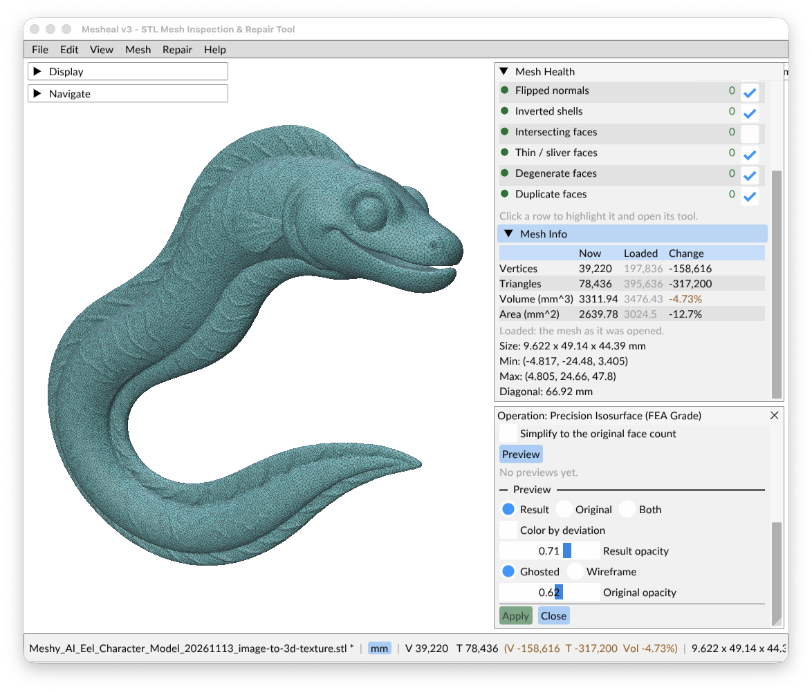

# Getting started

This walk-through uses the desktop app and a sample mesh, so you need no file of your own. The same
steps are in the app under **Help > Getting Started**.

## 1. Open a mesh

Start Mesheal (`mesheal`, or `Mesheal.app` on macOS) and choose
**File > Load Sample > Box with cavity, hole, slivers, and intersections**. It is a small box with one
of almost everything: a hole, thin faces, a fold and a peg pushed through its side, plus a hollow
inside that is correct and must be kept. To open your own file, use **File > Open...**
(`Cmd/Ctrl+O`), drag an STL into the window, or pass it on the command line: `mesheal part.stl`.

Then set the file's units in **Mesh > Units & Scale...**. This only labels the numbers: it never
moves the geometry. See [Units & Preferences](gui/units-and-preferences.md).

## 2. Check it

The **Mesh Health** panel on the right checks the mesh as soon as it loads. Each row is one kind of
problem, with a count:

- a **green** count means no problems of that kind,
- an **orange** count means problems were found,
- a **greyed count with `?`** means the mesh changed since that row last ran.

*Intersecting faces* is the slowest check, so it does not re-run on its own after every edit.
Press **Check Mesh** (`F5`) to run every row.

## 3. Look at a problem

Click a row, for example *Intersecting faces*. Its defects are tinted in the 3D view, and the row's
**tool** opens below Mesh Health, with settings, a list of defects and repair buttons.

- `N` / `Shift+N` step to the next or previous defect.
- `.` frames the focused defect. Press it again to look from the other side.
- `G` makes the mesh see-through (*Ghost Mesh*) so you can see defects inside.
- Click a defective face in 3D to focus it.

The mouse orbits, pans and zooms around the focused defect. See
[Navigation & Shortcuts](NAVIGATION.md), or press `F1` in the app.

## 4. Repair

You can repair at three levels:

| Level | How | When |
|---|---|---|
| Everything | **Repair > Fix All...** (`Shift+F5`) | Most meshes. Runs every repair in a safe order, for several passes. |
| One kind of problem | The green **Fix All** or **Repair All...** button in a row's tool | You want to control the order, or only one kind needs fixing. |
| One defect | The **Inspector** at the bottom of the tool, when one defect is focused | Delicate areas where you want to choose the exact repair. |

When local repair is not enough, **Repair > Remesh & Watertight Rebuild** rebuilds the whole surface.
See [Repairing](gui/repairs.md).

## 5. Compare and decide

Repairs preview first. The panel shows the change in volume and surface area, how far the surface
moved, whether the result is watertight, and which defects remain. Nothing changes until you press
**Apply**.

Every Apply is one undo step: **Edit > Undo** (`Cmd/Ctrl+Z`) goes back one step at a time. Try a
different repair and compare.



*After a Precision Isosurface rebuild, Mesh Info compares the result with the mesh as loaded:
80% fewer triangles and 4.7% less volume.*

## 6. Save

- **File > Save As > Binary STL...** (`Cmd/Ctrl+Shift+S`) or **ASCII STL...** writes a new file.
- **File > Save** (`Cmd/Ctrl+S`) writes over the file you opened. It asks the first time.

## Doing the same from the command line

```bash
mesheal part.stl --diagnostics               # step 2
mesheal part.stl --fix-all -o part_clean.stl # steps 4 and 6
mesheal part.stl --fix-all --json            # before/after numbers as JSON (step 5)
```

See the [CLI reference](CLI.md).
