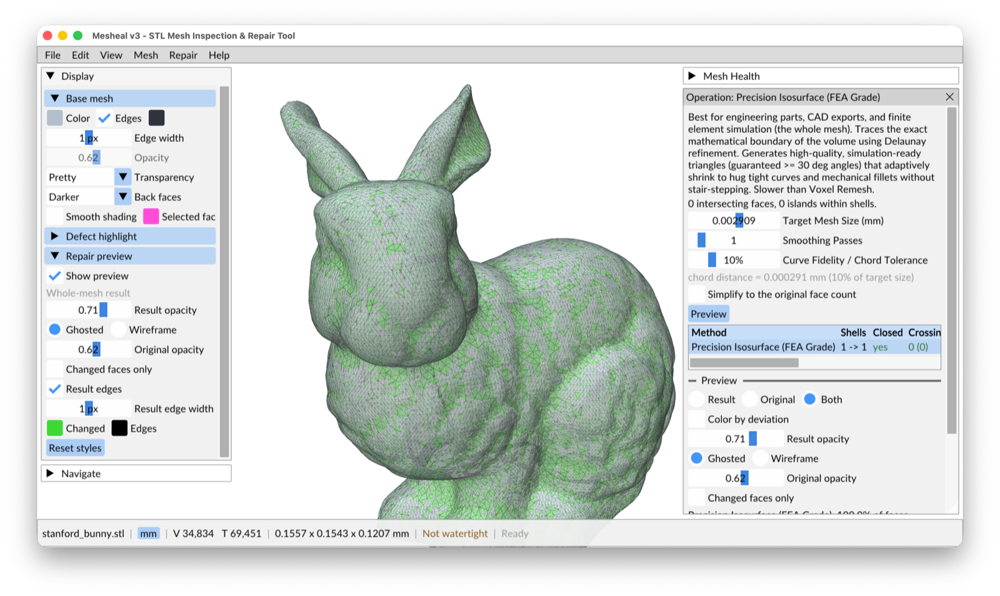

# Tour of the window

*The Stanford bunny with a Precision Isosurface rebuild previewed: the new mesh (changed faces in
green) is drawn over the ghosted original. Display is open on the left, the tool panel on the
right, and the status bar at the bottom shows the file, units, counts, size and the Watertight badge.*

| Area | What it is for |
|---|---|
| **Mesh Health** (top right) | What is wrong with the mesh: one row per kind of problem, with counts. See [Mesh Health](mesh-health.md). |
| **Tool panel** (below Mesh Health) | Opens when you pick a Mesh Health row or a menu operation. Shows settings, a defect list, repair buttons and the Inspector. Only one tool is open at a time. Drag its left edge to resize the right column. |
| **Display** (left) | How the mesh, the defect highlight and the repair preview are drawn: edges, opacity, transparency, back faces, smooth shading. |
| **Navigate** (left) | Standard views, Home, Next / Previous defect, and camera settings. Every button shows its keyboard shortcut in a tooltip. Once you know the keys you can collapse it. |
| **Shells** (left) | Only when the mesh has more than one separate piece. See [Shells](shells.md). |
| **Status bar** (bottom) | File name (`*` = modified), units (click to change), vertex and triangle counts, size, the **Watertight** badge, the last message, and progress with **Cancel** for background work. |

Each panel collapses to its title bar. **View > Reset Layout** restores the default layout.

## Menus

| Menu | Contents |
|---|---|
| **File** | Open, Open Recent (last 10 files), Load Sample, Save, Save As (binary or ASCII STL), Export Selected Shells, Quit. |
| **Edit** | Undo (names the last action), Select Defects (all, none, invert, next, previous), Select Faces (box, circle, all, none, X-ray), Preferences (`Cmd/Ctrl+,`). |
| **View** | Camera (Home, Frame selection, standard views, Orthographic), Compass, Ghost Mesh (`G`), Wireframe Edges, Advanced (Polyscope appearance, slice planes, clipping), Screenshot, Reset Layout. |
| **Mesh** | Operations that change the mesh but are not defect repairs: Units & Scale, Transform (Set Origin to Selection, Translate / Rotate), Shells, and under *Modify*: Decimate, Merge by Distance, Weld, Delete Selected Faces, Remove Small Shells. Mesh Info. |
| **Repair** | Check Mesh (`F5`), Fix All (`Shift+F5`), Fix All One Pass (`Alt+Shift+F5`), Remesh & Watertight Rebuild, and one *Fix All* / *Repair All* item per Mesh Health row. |
| **Help** | Getting Started, Navigation & Shortcuts (`F1` or `?`), Online Documentation, Report an Issue, About Mesheal. |

## Sample meshes

**File > Load Sample** has small meshes built to show one kind of problem each: a defective test
cube, a folded cube with intersection islands, touching cubes with a fin, holes of each shape,
boxes with cavities (correct, inside out, overlapping), cracked and seamed cubes, duplicate and
collapsed faces, tiny floating pieces, and more. Hover a sample for a description. They are a safe
way to try every repair.

## Selections

Mesheal has two kinds of selection:

- **Defects** of the open Mesh Health row: click them in 3D or in the list; `N` / `Shift+N` step
  through them.
- **Faces**, for the *Mesh > Modify* operations: `Shift+click` toggles one face, `B` box-selects,
  `C` paints with a circle, `A` selects all. Selected faces are magenta. Decimate, Merge by Distance,
  Weld and Fix All work on the selected faces when there are any.

See [Navigation & Shortcuts](../NAVIGATION.md) for every key and mouse binding.
