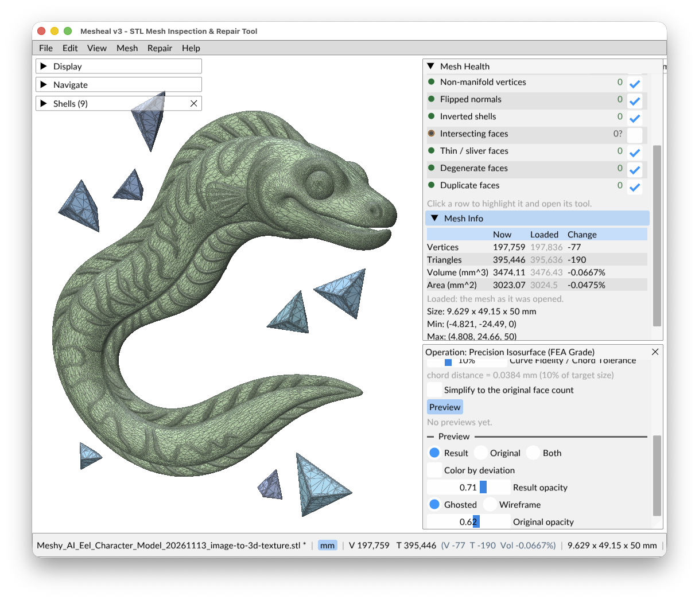

# Shells

A **shell** is one separate connected piece of the mesh. CAD exports and assemblies often have many:
a body, parts that cross it, and sometimes a hidden piece inside another. The **Shells** panel (left
column) appears when the mesh has more than one shell. Mesh Health says *what is wrong*; the Shells
panel says *which part you are working on*.

*An eel with loose pieces around it: nine shells, each in its own color.*

## The panel

Each row has a visibility box, a color swatch, the shell number (`#1` is the largest), its face count,
a health dot with the count of its own defects, and an **inside #k** tag when the shell lies inside
another one. Hover a row for a breakdown of its defects and the shells it crosses. Click a column
heading to sort by number, faces or health.

**Color by shell** (on by default) gives each shell a muted green, blue or purple, so the orange and
red defect tints stay readable.

## Selecting shells

| Action | How |
|---|---|
| Select a shell | Click its row, or `Alt+click` it in 3D |
| Add or remove one | `Cmd/Ctrl+click` the row, or `Alt+Cmd/Ctrl+click` in 3D |
| Select a range | `Shift+click` a row |
| Frame shells | Double-click a row, or `.` |
| Select by rule | **Select...**: All, None, Invert, Visible shells, Unhealthy, Nested inside another shell, smaller than N faces |

A plain click in 3D never changes the shell selection. It keeps picking defects of the open Mesh
Health row.

## Scope

With shells selected, everything in Mesh Health covers only those shells: counts, lists, Next /
Previous, the 3D tint, and Fix All. A blue *Scope* line says so, with a button to go back to all
shells. With nothing selected, the scope is all visible shells. Hidden shells are never checked,
listed or edited, but they are still saved.

Crossings between two shells only count when both are in scope. A per-row *Fix All* does not repair
them, because they are not a defect of either shell on its own. A merge removes them (see below).

## Actions

Right-click a shell, or use **Mesh > Shells**:

- **Frame** (`.`), **Isolate** (`I`: hide every other shell; press again to go back), **Hide**,
  **Hide All**, **Show All**.
- **Delete** (`Delete` / `Backspace`, one undo step).
- **Save As**: the selected shells to one STL, or each to its own STL. Also under
  **File > Export Selected Shells**.
- **Merge...**: unite the selected shells into one.

## Merge Shells

**Merge...** unites the selected shells (two or more) with a robust boolean union. It shows a
checklist first: each shell must be closed, manifold and consistently oriented. Shells that fail are
listed with a **Show** button. Self-crossings are only a warning.

Cavities (hollow shells facing inward inside a solid) are always kept. The merge runs in the
background with Cancel in the status bar, applies as one undo step, and reports the resulting
shells, faces and volume.

The top-level **Fix All** can also merge overlapping shells (step 10) and then cleans up the merged
result. See [Repairing](repairs.md#everything-fix-all).
