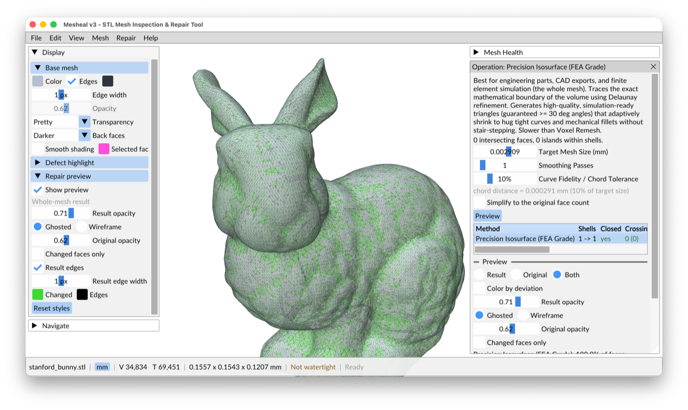

# Mesheal

**Mesheal inspects and repairs STL surface meshes for simulation.** Particle transport, FEA, CFD and
ray tracing codes need meshes that are watertight and 2-manifold, with every triangle facing the right
way. Mesheal finds what is wrong, offers repairs ranging from one triangle to the whole surface, and
shows you what each repair changes before you accept it.



*Stanford Bunny with Precision Isosurface preview, the changed faces in green over the ghosted original.*

It is free software (GPL-3.0-or-later) and comes in three forms:

<div class="grid cards" markdown>

- **Desktop app**

    ---

    An interactive 3D viewer with a live *Mesh Health* panel, repair previews with before/after
    numbers, and multi-step undo.

    [Getting started](getting-started.md)

- **Command line**

    ---

    Headless checks and repairs for scripts and pipelines, with optional JSON output. The input file
    is never overwritten.

    [CLI reference](CLI.md)

- **Python and Blender**

    ---

    A native Python module (NumPy in, NumPy out) and a Blender extension built on it.

    [Python module](python.md) · [Blender extension](blender.md)

</div>

## What it checks

| Topology | Geometry |
|---|---|
| Holes (open edges) | Intersecting faces |
| Non-manifold edges and vertices | Thin / sliver faces |
| Flipped normals | Degenerate faces |
| Inverted shells | Duplicate faces |
| Shells (separate pieces) | |

See [Mesh Health](gui/mesh-health.md) for what each check means.

## How it repairs

- **Fix All** runs every repair in a safe order, repeats it for several passes, and previews the
  result before anything changes.
- **One kind at a time:** each Mesh Health row has its own *Fix All* or *Repair All* button.
- **One defect at a time:** the Inspector offers local repairs (flip an edge, collapse an edge, fill a
  hole, cut out an intersection) with a live 3D preview.
- **Whole-surface rebuilds:** Shrink-Wrap, Voxel Heal & Remesh, and Precision Isosurface produce a
  watertight surface when local repair is not enough.

Every repair reports the change in volume and surface area and how far the surface moved. Every
repair is one undo step. See [Why Mesheal](why.md) for the thinking behind this.

## Quick start

```bash
# macOS
brew install cmake cgal boost
git clone https://github.com/jsweezy/mesheal.git
cd mesheal
cmake -B build_release -DCMAKE_BUILD_TYPE=Release
cmake --build build_release -j 2

./build_release/src/app/mesheal                         # desktop app
./build_release/src/app/mesheal part.stl --diagnostics  # headless check
./build_release/src/app/mesheal part.stl --fix-all      # writes part_fixed_1.stl
```

See [Install](install.md) for Linux and for installing the desktop app.
